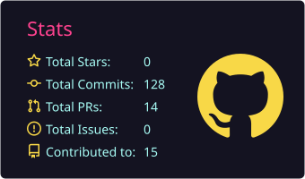
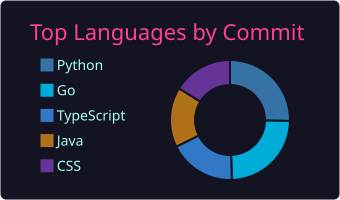

<h1 align="center">Hi, I'm Arnold Reis 👋</h1>

  <b>Software Developer · Back-End, AI & Automation</b> 
  Building reliable back-end services, integrations and AI-powered workflows.

  
  
  

## 👨‍💻 About me

- 💼 **Software Developer** at **Américo e Conrado**
- 🎓 **Software Engineering** graduate from **UTFPR** · postgraduate in **AI for Developers** at **FIAP** (in progress)
- 🔭 **Exploring:** AI agents, RAG, embeddings and local LLMs (Ollama)
- ⚙️ **Specialties:** Back-End Development, System Architecture and Workflow Automation (n8n, Webhooks, APIs)
- 🌎 **Languages:** Portuguese · English

## 🛠️ Tech Stack

**Languages**

  

**Back-End & Databases**

  

  
  
  

**DevOps & Tools**

  

**Automation & AI**

  
  
  
  
  

## 🚀 Featured Projects

| Project | Highlights |
| :--- | :--- |
| [**ResiliQ**](https://github.com/ArnoldReis/ResiliQ) | Distributed queues in Go: idempotency, retries, DLQ and observability |
| [**Cattle Behavior Detection on SBCs**](https://github.com/ArnoldReis/deteccao-comportamental-bovinos-sbc) | UTFPR thesis: computer vision, multiple detectors, device constraints and reproducible benchmarks |
| [**Collaborative Editor**](https://github.com/ArnoldReis/Editor_Colaborativo) | Real-time collaboration with Yjs CRDTs, persistence and offline support |
| [**EncurtaLink**](https://github.com/ArnoldReis/EncurtaLink) | Fastify URL shortener API with analytics, validation and rate limiting |
| [**Internet Monitoring Dashboard**](https://github.com/ArnoldReis/Dashboard_Analisedeinternet) | Connectivity diagnostics, dashboards and monitoring alerts |

  <a href="https://arnoldreis.vercel.app/"><b>See more projects and case studies on my portfolio →</b></a>

## 📊 GitHub Stats

<!-- Cards gerados pelo workflow .github/workflows/profile-summary-cards.yml (não dependem de servidores externos) -->

  

  
  

  
<b>🇧🇷 Em português</b>

   
  Sou <b>Desenvolvedor de Software</b> na <b>Américo e Conrado</b>, formado em Engenharia de Software pela <b>UTFPR</b> e pós-graduando em <b>IA para Devs na FIAP</b>.
  Trabalho com back-end, integrações e automações (TypeScript, Node.js, Fastify, SQL Server, Redis e n8n) e estudo agentes de IA, RAG e modelos locais.
  Conheça meus projetos e cases no <a href="https://arnoldreis.vercel.app/">portfólio</a>.

