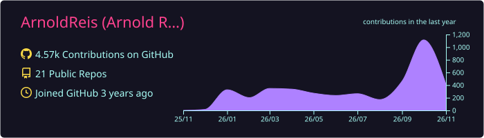

<h1 align="center">Hi, I'm Arnold! 👋</h1>

<h3 align="center">Software Engineering @UTFPR | ⚙️ Focused on Automation, AI & Software Architecture | 🚀 Building smart solutions</h3>

  
  

---

### 👨‍💻 About me

- 🎓 **Education:** Software Engineering at UTFPR
- 💼 **Experience:** Software Developer at Américo e Conrado
- 🚀 **Currently building:** ...
- ⚙️ **Specialties:** Back-End Development, Artificial Intelligence, System Architecture, and Workflow Automation (n8n, Webhooks, AI Agents)

---

### 🛠️ Skills & Tools

**Languages & Frameworks**

  

**Databases & Infrastructure**

  

**Automation, APIs & Engineering**

  
  
  
  

---

### 📊 GitHub Stats

<!-- Cards gerados pelo workflow .github/workflows/profile-summary-cards.yml (não dependem de servidores externos) -->

  

  
  

