<!-- Animated, local SVG banner. Works as a static illustration if reduced motion is enabled. -->

  

<h1 align="center">Hi, I'm Arnold! 👋</h1>

<h3 align="center">Software Engineer · Backend Development · AI & Automation</h3>

  
  
  

  
  
  

---

### 👨‍💻 About me

- 🎓 **Education:** Software Engineering at **UTFPR**, with postgraduate studies in **AI for Developers at FIAP**.
- 💼 **Experience:** Software development, backend integrations, and automation of real-world processes.
- 🚀 **Exploring:** AI agents, local language models, reliable workflows, and developer tooling.
- ⚙️ **Specialties:** Back-End Development, Artificial Intelligence, Software Architecture, and Workflow Automation (**n8n**, Webhooks, APIs).

---

### 🛠️ My Skills & Tools

**Languages & Frameworks:**

  

**Databases & Infrastructure:**

  

**Automation, APIs & Engineering:**

  
  
  
  

---

### 🚀 Featured Projects

| Project | What you'll find |
| :--- | :--- |
| [**ResiliQ**](https://github.com/ArnoldReis/ResiliQ) | Resilient queues, retries, idempotency and observability. |
| [**EncurtaLink**](https://github.com/ArnoldReis/EncurtaLink) | API design, URL shortening and backend engineering. |
| [**Cattle Behavior Detection**](https://github.com/ArnoldReis/deteccao-comportamental-bovinos-sbc) | Computer vision with real-world hardware constraints. |

  <a href="https://arnoldreis.vercel.app/"><b>Explore more projects and case studies →</b></a>

---

### 📊 GitHub Stats

  
  

Always learning, always building · 🇧🇷 PT / 🇺🇸 EN

